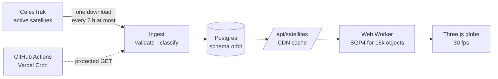
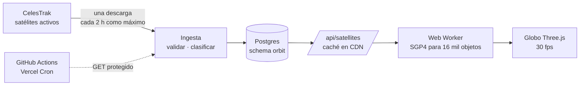

# Orbit

[English](#english) · [Español](#español)

**Live:** [orbit.riverogz.com](https://orbit.riverogz.com)

---

## English

A live 3D globe with every active satellite — more than 16,000 of them — moving in real time. Find the ISS, Hubble or a Starlink, see its orbit, and ask what is above you right now.

Nothing is simulated: positions come from the same orbital elements the U.S. Space Force publishes, propagated in your browser with SGP4, the model used to track satellites.



### Design decisions

**Visitors never touch CelesTrak.** CelesTrak refreshes the elements every 2 hours and, since 2026, blocks clients that download unchanged data. A cron downloads once, stores the snapshot, and every visitor reads it from our API, cached at the CDN for 30 minutes. The ingest endpoint skips any run within 2 hours of the last good one, so a delayed or doubled trigger never repeats a download.

**The browser does the physics.** The server stores elements, not positions. A Web Worker propagates all ~16,600 objects once a second (about 15 ms) and the globe interpolates between samples every frame, so the main thread never stalls.

**One download, split by name.** CelesTrak asks not to fetch overlapping groups, so a single "active" download is classified locally: Starlink, communications, navigation, Earth observation, stations, science. GLONASS satellites, published under the generic "COSMOS" name, are recognised by their orbit.

**Safety brake on the snapshot.** If a download is less than half the size of what is stored, it is treated as a source problem and the previous snapshot is kept. The swap happens in one transaction: readers see the old data or the new, never a mix.

**A small payload.** The feed rounds every number to the precision of the TLE format itself and sends categories as indices, which brings 16k objects to about 680 KB compressed.

**The real sky.** The day–night terminator follows the actual position of the Sun, and "What is above me?" computes, on the device, which satellites are over your horizon and when the ISS passes next. The location is never sent anywhere.

**Constant 30 fps.** A steady 30 looks smoother than a rate that alternates between 60 and 30, and it behaves the same on phones and weak GPUs.

### Security

- Own CSP with `frame-ancestors 'none'` and `object-src 'none'`, HSTS, `X-Frame-Options`, `X-Content-Type-Options`, `Referrer-Policy` and a `Permissions-Policy` that only allows geolocation on this origin.
- The ingest endpoint checks its secret from a header only, in **constant time** (`timingSafeEqual`).
- Errors are logged on the server; clients get a generic message, and the public cron job discards response bodies.
- Row Level Security is enabled on every table with no policies, so a stray grant can never expose the schema.

### Stack

Next.js 16 (App Router) · TypeScript `strict` · Tailwind v4 · Drizzle ORM · Postgres (Supabase, transaction pooler) · Three.js · satellite.js (SGP4) · Vercel behind Cloudflare.

### Structure

```
app/           page, layout and API routes (satellites, cron, health)
lib/
  globe/       Three.js engine, Earth shaders, satellite layer, SGP4 worker
  components/  UI
  services/    CelesTrak download, ingest, snapshot reads
  db/          Drizzle client and schema
  assets/      i18n, category rules and colours
  utils/       cache, classification, formatting
drizzle/       SQL migrations
```

### Development

```bash
npm install
cp .env.example .env.local     # DATABASE_URL, DIRECT_URL, CRON_SECRET
npm run db:migrate
npm run dev
```

For local work, save one CelesTrak download and point `CELESTRAK_FIXTURE` at it: the ingest then reads the file instead of downloading again.

### Credits and license

Orbital data from [CelesTrak](https://celestrak.org). Earth imagery from NASA's Blue Marble and Black Marble (public domain). The source code is released under the [MIT License](LICENSE); the data and imagery keep their own terms.

### Author

Built by **Jhon Rivero** — [GitHub](https://github.com/JhonRiv21) · [Portfolio](https://jhon.riverogz.com/)

---

## Español

Un globo 3D en vivo con todos los satélites activos —más de 16.000— moviéndose en tiempo real. Encuentra la ISS, el Hubble o un Starlink, mira su órbita y pregunta qué hay sobre ti en este momento.

Nada es simulado: las posiciones salen de los mismos elementos orbitales que publica la Fuerza Espacial de EE. UU., propagados en tu navegador con SGP4, el modelo que se usa para rastrear satélites.



### Decisiones de diseño

**Los visitantes nunca tocan CelesTrak.** CelesTrak actualiza los elementos cada 2 horas y, desde 2026, bloquea a quien descarga datos sin cambios. Un cron descarga una vez, guarda la foto y cada visitante la lee desde nuestra API, cacheada 30 minutos en la CDN. El endpoint de ingesta se salta cualquier ejecución a menos de 2 horas de la última buena, así que un disparo retrasado o duplicado nunca repite una descarga.

**La física la hace el navegador.** El servidor guarda elementos, no posiciones. Un Web Worker propaga los ~16.600 objetos una vez por segundo (unos 15 ms) y el globo interpola entre muestras en cada cuadro, así que el hilo principal nunca se traba.

**Una descarga, repartida por nombre.** CelesTrak pide no descargar grupos que se solapan, así que una sola descarga de «activos» se clasifica en local: Starlink, comunicaciones, navegación, observación de la Tierra, estaciones y ciencia. Los GLONASS, publicados con el nombre genérico «COSMOS», se reconocen por su órbita.

**Freno de seguridad en la foto.** Si una descarga trae menos de la mitad de lo guardado, se trata como un problema de la fuente y se conserva la foto anterior. El cambio ocurre en una sola transacción: quien lee ve los datos viejos o los nuevos, nunca una mezcla.

**Un payload pequeño.** El feed redondea cada número a la precisión del propio formato TLE y envía las categorías como índices, lo que deja 16 mil objetos en unos 680 KB comprimidos.

**El cielo real.** El terminador entre el día y la noche sigue la posición real del Sol, y «¿Qué hay sobre mí?» calcula en el dispositivo qué satélites están sobre tu horizonte y cuándo pasa la ISS. La ubicación nunca se envía a ningún lado.

**30 fps constantes.** Unos 30 estables se ven más fluidos que una tasa que alterna entre 60 y 30, y el globo se comporta igual en celulares y GPUs modestas.

### Seguridad

- CSP propia con `frame-ancestors 'none'` y `object-src 'none'`, HSTS, `X-Frame-Options`, `X-Content-Type-Options`, `Referrer-Policy` y una `Permissions-Policy` que solo permite la geolocalización en este origen.
- El endpoint de ingesta valida su secreto solo por cabecera y en **tiempo constante** (`timingSafeEqual`).
- Los errores se registran en el servidor; el cliente recibe un mensaje genérico y el job público del cron descarta el cuerpo de las respuestas.
- Row Level Security activo en todas las tablas sin policies, para que un grant accidental nunca exponga el schema.

### Stack

Next.js 16 (App Router) · TypeScript `strict` · Tailwind v4 · Drizzle ORM · Postgres (Supabase, transaction pooler) · Three.js · satellite.js (SGP4) · Vercel tras Cloudflare.

### Estructura

```
app/           página, layout y rutas de API (satellites, cron, health)
lib/
  globe/       motor Three.js, shaders de la Tierra, capa de satélites, worker SGP4
  components/  interfaz
  services/    descarga de CelesTrak, ingesta, lectura de la foto
  db/          cliente y schema de Drizzle
  assets/      i18n, reglas y colores de categorías
  utils/       caché, clasificación, formato
drizzle/       migraciones SQL
```

### Desarrollo

```bash
npm install
cp .env.example .env.local     # DATABASE_URL, DIRECT_URL, CRON_SECRET
npm run db:migrate
npm run dev
```

Para trabajar en local, guarda una descarga de CelesTrak y apunta `CELESTRAK_FIXTURE` a ella: la ingesta lee el archivo en vez de descargar otra vez.

### Créditos y licencia

Datos orbitales de [CelesTrak](https://celestrak.org). Imágenes de la Tierra del Blue Marble y el Black Marble de la NASA (dominio público). El código se publica bajo la [licencia MIT](LICENSE); los datos y las imágenes conservan sus propios términos.

### Autor

Creado por **Jhon Rivero** — [GitHub](https://github.com/JhonRiv21) · [Portafolio](https://jhon.riverogz.com/)
